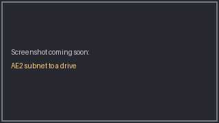

---
navigation:
  title: "AE2 in Apex"
  parent: automation/automation-index.md
  position: 10
  icon: ae2:controller
---

# AE2 in Apex

AE2's own guide (hold G over any AE2 item) explains how AE2 works. In Apex its crafting recipes move into the
GregTech assembler at a tier (same ingredients + soldering alloy):

| Tier | AE2 |
|---|---|
| LV | Network basics, 1k storage, buses, terminals. **No autocrafting.** |
| MV | 4k / 16k cells, autocrafting (crafting CPU, pattern provider, molecular assembler, interface), P2P |
| HV | Everything else (the default) |
| EV | Quantum link / ring, spatial, big crafting accelerators, assembler matrix |
| IV | AdvancedAE quantum computer and quantum armor, very large cells |
| ZPM | MEGA Cells (1M-16M, MEGA crafting CPU, MEGA interface / pattern provider) |
| UV | MEGA 64M / 256M; InsaneAE basics |
| UHV-UIV | InsaneAE T / P / E cells, quantum CPU, top energy cells |

InsaneAE's machine acceleration cards are disabled. GregTech machines connect to AE2 with ME input / output buses
and hatches; the [Extreme Craft Center](../multiblocks/extreme_craft_center.md) is an ME crafting provider with pattern magnification.

## Quests

These quests cover this page. Click one to open it in the quest book.

* <QuestLink id="1D174BA0FA98E25D">Applied Energistics Begins</QuestLink> (Tier 1 - LV)
* <QuestLink id="21E356D1F3E106AA">Subnets</QuestLink> (AE2 and Automation)
* <QuestLink id="313BF2CFD1802BD0">ME Storage Multiblock</QuestLink> (Tier 7 - ZPM)
* <QuestLink id="36D26A05E1C2D161">MEGA 64M Cells</QuestLink> (Tier 8 - UV)
* <QuestLink id="420128C2362B7294">Nexus Molecular Forge</QuestLink> (Tier 7 - ZPM)
* <QuestLink id="4B2CEFC0C3D8C2CA">MEGA Cells</QuestLink> (Tier 7 - ZPM)
* <QuestLink id="5B0918EBF064B8B7">Quantum Network Bridge</QuestLink> (Tier 4 - EV)
* <QuestLink id="7EDDDB0528C4EFDC">Applied Energistics</QuestLink> (AE2 and Automation)
