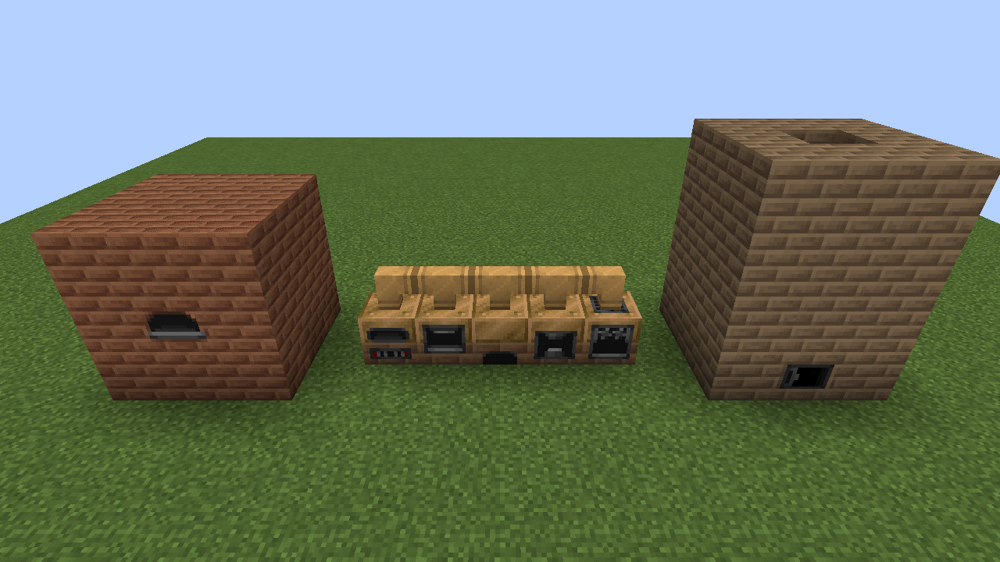

---
navigation:
  title: "Boilers and Steam"
  parent: gregtech/gregtech-index.md
  position: 31
  icon: gtceu:lp_steam_solid_boiler
item_ids:
- gtceu:lp_steam_solid_boiler
- gtceu:hp_steam_solid_boiler
- gtceu:lp_steam_liquid_boiler
- gtceu:hp_steam_liquid_boiler
- gtceu:lp_steam_solar_boiler
- gtceu:hp_steam_solar_boiler
---

# Boilers and Steam

Steam runs everything before LV, and keeps running LV through steam turbines. A boiler turns water and fuel into
steam; steam machines and turbines use it.

## Small boilers

| Boiler | Fuel | Steam at full heat |
|---|---|---|
| <ItemLink id="gtceu:lp_steam_solid_boiler" /> | coal, coke, charcoal, wood... | 120 mB/s (6 mB/t) |
| <ItemLink id="gtceu:hp_steam_solid_boiler" /> | same | 300 mB/s (15 mB/t) |
| <ItemLink id="gtceu:lp_steam_liquid_boiler" /> | lava, creosote and other fluid fuels | 240 mB/s (12 mB/t) |
| <ItemLink id="gtceu:hp_steam_liquid_boiler" /> | same | 600 mB/s (30 mB/t) |
| <ItemLink id="gtceu:lp_steam_solar_boiler" /> | daylight with open sky | 120 mB/s (6 mB/t) |
| <ItemLink id="gtceu:hp_steam_solar_boiler" /> | same | 360 mB/s (18 mB/t) |

JEI's boiler fuel category lists every fuel and how long it burns.

## How a boiler works

* **It heats up slowly.** A cold boiler makes no steam. Steam starts once it is about a tenth of the way hot,
  and output grows with the heat bar until it is full. From cold to full takes about **10 minutes** for both the
  bronze and the steel boilers.
* **It cools down when the fuel runs out**, so keep it fed. A hopper or a pipe into the fuel slot is enough.
* **It pushes steam out by itself** into anything next to it, on every side except the front and the bottom.
  Put steam machines right against its sides, back or top, or run a bronze fluid pipe.
* **Solid boilers make ash.** Take it out of the ash slot from time to time, or pull it out with a pipe.
* **When the steam tank is full**, the boiler vents steam out of its front and wastes it. That's harmless.
* **Water**: boilers use very little, but they must never run dry while hot.

<Color id="red">If a hot boiler runs out of water and you then add water, it explodes. If one runs dry, let it cool
down (or break it) before refilling.</Color> A steady water supply is the safe setup: a primitive pump, or an electric
pump on a water source, piped straight into the boiler.

## How much steam machines use

A steam machine burns **steam in place of EU**, and only runs recipes up to 32 EU/t (LV).

* **Bronze (low pressure)**: 1 mB of steam per EU, but recipes take **twice as long**.
* **Steel (high pressure)**: 2 mB of steam per EU, at normal speed.

So both use the same steam per item; the steel machine is just twice as fast. One bronze solid boiler at full heat
(6 mB/t) runs a bronze machine on a 4 EU/t recipe with steam to spare. Watch the steam bar in the machine GUI:
if it sits empty, add a boiler.

Steam machines **vent** after every recipe out of their output side (set it with a wrench). A blocked vent pauses
the machine, and the steam hurts anyone standing in front of it.

## Steam into EU

A <ItemLink id="gtceu:lv_steam_turbine" /> turns 2 mB of steam into 1 EU. At its full 32 EU/t it needs 64 mB/t:
about ten bronze solid boilers, or four or five steel ones. With less steam it just runs part of the time, so start
with what you have and add boilers. This is the normal way to power your first LV machines; see
[LV](../progression/01-lv.md). A [Large Boiler](../gtmultis/large_boilers.md) feeds several turbines on its own.

## Going bigger

* [Large Boilers](../gtmultis/large_boilers.md) (bronze, steel, titanium, tungstensteel) make thousands of mB per
  tick and feed large steam turbines.
* [Steam Multiblocks](../gtmultis/steam-multiblocks.md) run steam recipes with up to 8 parallels in Apex.

## Quests

These quests cover this page. Click one to open it in the quest book.

* <QuestLink id="06127E82742E1D33">Why Boilers Explode</QuestLink> (Tier 0.5 - Steam Age)
* <QuestLink id="08DEADE3AAD93436">High Pressure Boilers</QuestLink> (Tier 0.5 - Steam Age)
* <QuestLink id="0C82E3AE5EDAF149">Mind the Exhaust</QuestLink> (Tier 0.5 - Steam Age)
* <QuestLink id="1767C233669E14D1">Solar Boiler</QuestLink> (Tier 0.5 - Steam Age)
* <QuestLink id="38128FAF517ED63A">Steam Into Power</QuestLink> (Tier 1 - LV)
* <QuestLink id="5E6C4C3915ED19FE">Infinite Water</QuestLink> (Tier 0.5 - Steam Age)
* <QuestLink id="7F7588DE49CC05E8">Stoke the Boiler</QuestLink> (Tier 0.5 - Steam Age)
