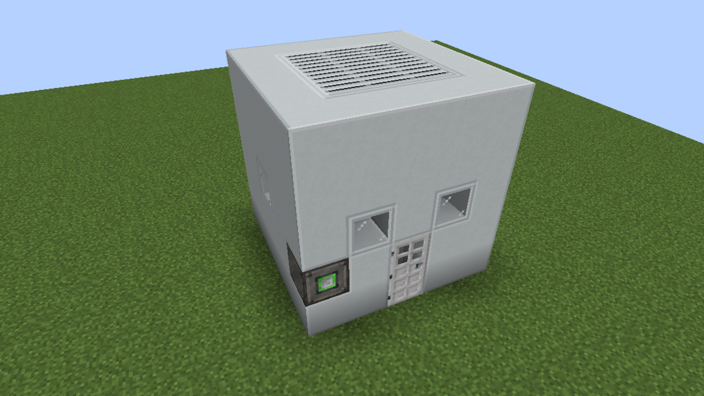

---
navigation:
  title: "Cleanroom"
  parent: gregtech/gregtech-index.md
  position: 80
  icon: gtceu:cleanroom
---

# Cleanroom

Advanced circuits and wafers need a <ItemLink id="gtceu:cleanroom" />: a hollow box of
<ItemLink id="gtceu:plascrete" /> with <ItemLink id="gtceu:filter_casing" /> covering the ceiling, a door, and the
controller in the middle of the ceiling. Machines inside get the clean environment. Sterile cleanrooms (later)
are needed for wetware, optical and higher circuits.

<Multiblock id="gtceu:cleanroom" />

<GTRecipesFor id="gtceu:cleanroom" limit="1" />
