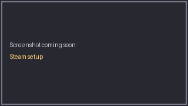

---
navigation:
  title: "Stone Age and Steam"
  parent: progression/progression-index.md
  position: 10
  icon: gtceu:lp_steam_solid_boiler
---

# Stone Age and Steam

**Goal:** steel, bronze, a steam setup, and the materials for your first LV machines.

## Checklist

1. Tools from flint and iron; a <ItemLink id="gtceu:iron_hammer" /> for plates.
2. A **Tinkers smeltery** (lava fuel) for early metal parts.
3. **Coke Oven** -> coal coke and creosote. **Primitive Blast Furnace** -> steel.
4. **Bronze** (copper + tin) and the **steam machines**: a solid-fuel boiler
   (<ItemLink id="gtceu:lp_steam_solid_boiler" />), then <ItemLink id="gtceu:lp_steam_macerator" />,
   <ItemLink id="gtceu:lp_steam_extractor" />, <ItemLink id="gtceu:lp_steam_compressor" />,
   <ItemLink id="gtceu:lp_steam_forge_hammer" />, <ItemLink id="gtceu:lp_steam_alloy_smelter" />.
5. Upgrade to **high pressure** (steel) steam machines. Rubber (from rubber trees or later chemistry) for cables.
6. Visit the **Nether**: sulfur, quartz, redstone, saltpeter veins; blazes for blaze rods.
7. **Botania basics** work at steam level: Pure Daisy, Petal Apothecary, Mana Pool, generating flowers
   (see [Botania](../magic/botania.md)).

The steam-age multis from GTNA (large steam machines) are good, but the Steam Lava Maker and the
Dimensionally Transcendent Steam Oven are LV / MV recipes in Apex.

## Coke Oven

<GameScene zoom="5" interactive={true}>
  <Block id="gtceu:coke_oven_bricks" x="0" y="0" z="0" /><Block id="gtceu:coke_oven_bricks" x="1" y="0" z="0" /><Block id="gtceu:coke_oven_bricks" x="2" y="0" z="0" />
  <Block id="gtceu:coke_oven_bricks" x="0" y="0" z="1" /><Block id="gtceu:coke_oven_bricks" x="1" y="0" z="1" /><Block id="gtceu:coke_oven_bricks" x="2" y="0" z="1" />
  <Block id="gtceu:coke_oven_bricks" x="0" y="0" z="2" /><Block id="gtceu:coke_oven_bricks" x="1" y="0" z="2" /><Block id="gtceu:coke_oven_bricks" x="2" y="0" z="2" />
  <Block id="gtceu:coke_oven_bricks" x="0" y="1" z="0" /><Block id="gtceu:coke_oven_bricks" x="1" y="1" z="0" /><Block id="gtceu:coke_oven_bricks" x="2" y="1" z="0" />
  <Block id="gtceu:coke_oven_bricks" x="0" y="1" z="1" /><Block id="gtceu:coke_oven_bricks" x="2" y="1" z="1" />
  <Block id="gtceu:coke_oven_bricks" x="0" y="1" z="2" /><Block id="gtceu:coke_oven" x="1" y="1" z="2" /><Block id="gtceu:coke_oven_bricks" x="2" y="1" z="2" />
  <Block id="gtceu:coke_oven_bricks" x="0" y="2" z="0" /><Block id="gtceu:coke_oven_bricks" x="1" y="2" z="0" /><Block id="gtceu:coke_oven_bricks" x="2" y="2" z="0" />
  <Block id="gtceu:coke_oven_bricks" x="0" y="2" z="1" /><Block id="gtceu:coke_oven_bricks" x="1" y="2" z="1" /><Block id="gtceu:coke_oven_bricks" x="2" y="2" z="1" />
  <Block id="gtceu:coke_oven_bricks" x="0" y="2" z="2" /><Block id="gtceu:coke_oven_bricks" x="1" y="2" z="2" /><Block id="gtceu:coke_oven_bricks" x="2" y="2" z="2" />
  <IsometricCamera yaw="195" pitch="30" />
</GameScene>

A 3x3x3 of <ItemLink id="gtceu:coke_oven_bricks" /> with a hollow middle and the <ItemLink id="gtceu:coke_oven" />
in the middle of one side. Coal becomes **coal coke** (a better fuel) and **creosote**. A
<ItemLink id="gtceu:coke_oven_hatch" /> in the wall lets pipes and hoppers work with it.

## Primitive Blast Furnace

<GameScene zoom="5" interactive={true}>
  <Block id="gtceu:firebricks" x="0" y="0" z="0" /><Block id="gtceu:firebricks" x="1" y="0" z="0" /><Block id="gtceu:firebricks" x="2" y="0" z="0" />
  <Block id="gtceu:firebricks" x="0" y="0" z="1" /><Block id="gtceu:firebricks" x="1" y="0" z="1" /><Block id="gtceu:firebricks" x="2" y="0" z="1" />
  <Block id="gtceu:firebricks" x="0" y="0" z="2" /><Block id="gtceu:firebricks" x="1" y="0" z="2" /><Block id="gtceu:firebricks" x="2" y="0" z="2" />
  <Block id="gtceu:firebricks" x="0" y="1" z="0" /><Block id="gtceu:firebricks" x="1" y="1" z="0" /><Block id="gtceu:firebricks" x="2" y="1" z="0" />
  <Block id="gtceu:firebricks" x="0" y="1" z="1" /><Block id="gtceu:firebricks" x="2" y="1" z="1" />
  <Block id="gtceu:firebricks" x="0" y="1" z="2" /><Block id="gtceu:primitive_blast_furnace" x="1" y="1" z="2" /><Block id="gtceu:firebricks" x="2" y="1" z="2" />
  <Block id="gtceu:firebricks" x="0" y="2" z="0" /><Block id="gtceu:firebricks" x="1" y="2" z="0" /><Block id="gtceu:firebricks" x="2" y="2" z="0" />
  <Block id="gtceu:firebricks" x="0" y="2" z="1" /><Block id="gtceu:firebricks" x="2" y="2" z="1" />
  <Block id="gtceu:firebricks" x="0" y="2" z="2" /><Block id="gtceu:firebricks" x="1" y="2" z="2" /><Block id="gtceu:firebricks" x="2" y="2" z="2" />
  <Block id="gtceu:firebricks" x="0" y="3" z="0" /><Block id="gtceu:firebricks" x="1" y="3" z="0" /><Block id="gtceu:firebricks" x="2" y="3" z="0" />
  <Block id="gtceu:firebricks" x="0" y="3" z="1" /><Block id="gtceu:firebricks" x="2" y="3" z="1" />
  <Block id="gtceu:firebricks" x="0" y="3" z="2" /><Block id="gtceu:firebricks" x="1" y="3" z="2" /><Block id="gtceu:firebricks" x="2" y="3" z="2" />
  <IsometricCamera yaw="195" pitch="30" />
</GameScene>

<ItemLink id="gtceu:firebricks" />, 3 wide, 4 tall, hollow in the middle and open on top, controller low on one side.
Iron + coal / coal coke / charcoal -> **steel** (and ash). Slow, so build several.
