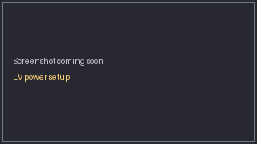

---
navigation:
  title: "LV (32 V)"
  parent: progression/progression-index.md
  position: 20
  icon: gtceu:lv_machine_hull
---

# LV - Low Voltage (32 V)

**Goal:** your first electric machines, a steady power supply and the Electric Blast Furnace.

## Checklist

1. <ItemLink id="gtceu:lv_machine_hull" /> needs steel and tin cables. **LV circuits**:
   <ItemLink id="gtceu:basic_electronic_circuit" /> (vacuum tubes, resistors, boards).
2. Power: <ItemLink id="gtceu:lv_steam_turbine" /> off your boilers, or <ItemLink id="gtceu:lv_combustion" /> on
   biodiesel / creosote / oil fuels. Store it in a battery buffer
   (see [Batteries](../gregtech/power/batteries.md)). Learn the [tools](../gregtech/tools.md) now: wrench,
   screwdriver and wire cutter set up every machine and cable.

   
3. Machines: Macerator, Ore Washer, Centrifuge, Electrolyzer, Wiremill, Bender, Lathe, Extruder, **Assembler**
   (most mods' recipes run in it), Chemical Reactor, Fluid Solidifier.
4. The <ItemLink id="gtceu:electric_blast_furnace" /> with cupronickel coils (see
   [EBF and coils](../gregtech/ebf-and-coils.md)). Two LV energy hatches let it run MV recipes like aluminium early.
5. Rubber in bulk (Chemical Reactor + sulfur) for insulated cables.

## Unlocks

* **AE2** network basics: 1k storage, buses, terminals (no autocrafting yet). See [AE2 in Apex](../automation/ae2.md).
* **Blood Magic**: the [Weak Blood Orb](../magic/blood-magic.md) from an LV Raw Blood Orb.
* **Botania**: Runic Altar, mechanical daisy / apothecary.
* [Mystical Cultivation Array](../multiblocks/mystical_cultivation_array.md): crop farming multiblock.
* Hostile Neural Networks' Deep Learner and Prediction Matrix (handcrafted).

<GTRecipesFor id="gtceu:lv_machine_hull" limit="1" />

## Quests

These quests cover this page. Click one to open it in the quest book.

* <QuestLink id="59173BF27618B570">Electricity</QuestLink> (Tier 0.5 - Steam Age)
* <QuestLink id="5F8B83C09B5FEAED">Tier 1: LV</QuestLink> (Tier 1 - LV)
