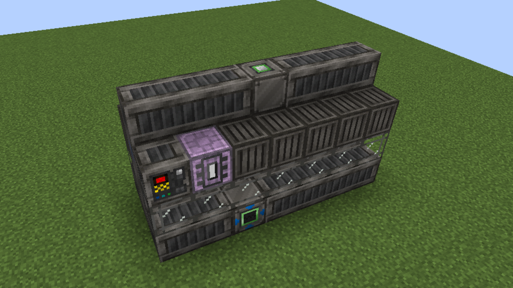

---
navigation:
  title: "IV (8,192 V)"
  parent: progression/progression-index.md
  position: 60
  icon: gtceu:iv_machine_hull
---

# IV - Insane Voltage (8,192 V)

**Goal:** the platinum line, the Assembly Line and the first wave of Apex multis.

## Checklist

1. **Platinum group** from sheldonite (End) and byproducts: platinum, palladium, then iridium / osmium / rhodium / ruthenium.
2. <ItemLink id="gtceu:iv_machine_hull" />, crystal processors later. HSS-G coils.
3. <ItemLink id="gtceu:assembly_line" /> (research data for some recipes).

   <Multiblock id="gtceu:assembly_line" />

   
4. Power: <ItemLink id="gtceu:steam_large_turbine" /> / <ItemLink id="gtceu:gas_large_turbine" />, or the
   [Large Naquadah Reactor](../multiblocks/large_naquadah_reactor.md).

## Unlocks

* **End** ores (platinum, naquadah, tungsten), **Venus / Mercury** (ostrum rockets), the jet suit.
* **Blood Magic**: Archmage orb, [Bloody Hell](../multiblocks/bloody_hell.md).
* **Botania** post-Gaia on the [Alfheim Teleportation Array](../multiblocks/alfheim_teleportation_array.md).
* Draconic Evolution base tier. AE2: AdvancedAE quantum computer, very large cells.
* Apex multis: [Library of Ruina](../multiblocks/library_of_ruina.md), [Component Assembly Line](../multiblocks/component_assembly_line.md),
  [Extreme Craft Center](../multiblocks/extreme_craft_center.md), [Nether Interface](../multiblocks/nether_interface.md),
  [Silicon Rock Synthesizer](../multiblocks/silicon_rock_synthesizer.md).

<GTRecipesFor id="gtceu:iv_machine_hull" limit="1" />
